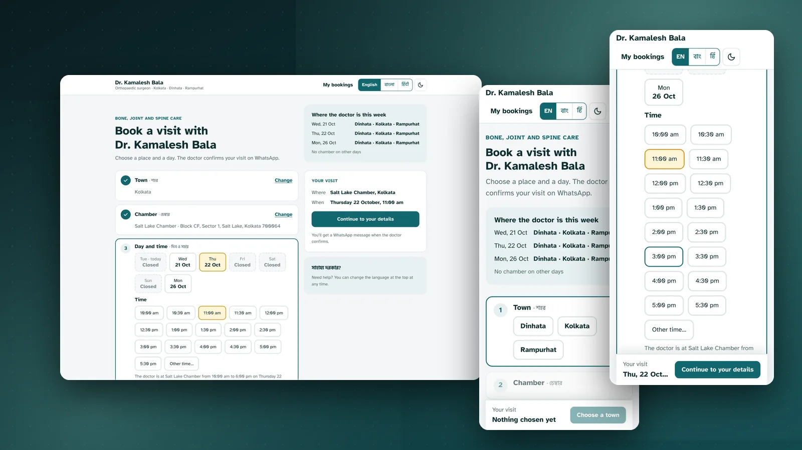
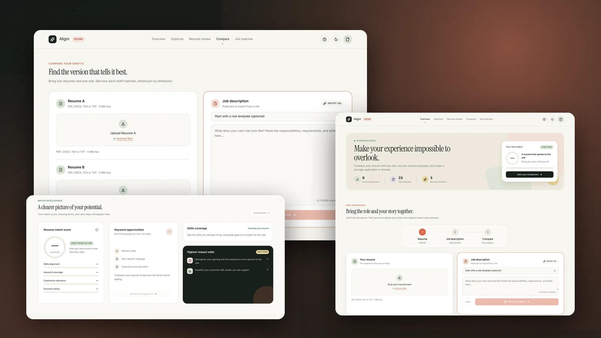
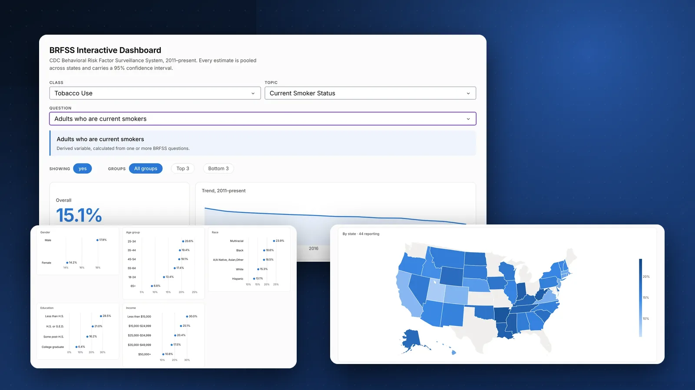
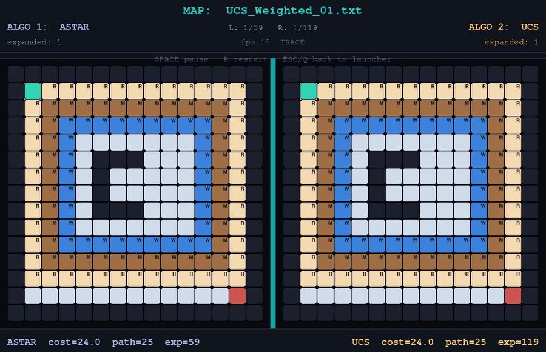

  <picture>
    <source media="(prefers-color-scheme: light)" srcset="assets/banner-light.svg">
    
  </picture>

  Data science grad student at Northeastern who loves building things people actually use. 
  <!--live-->5<!--/live--> live apps so far, plus NLP, vision and search projects.

  M.S. Data Science — Khoury College of Computer Sciences, Northeastern University

  
  

  <a href="#featured-work">Featured work</a> ·
  <a href="#academic--portfolio-projects">Academic</a> ·
  <a href="#stack">Stack</a> ·
  <a href="#resources">Resources</a> ·
  <a href="https://swapportfolio.vercel.app">Portfolio ↗</a>

## About Me

I'm a data science grad student who spends most of his time building things and figuring out why they broke.

My work tends to sit somewhere across:
- Applied Machine Learning
- Backend Systems
- Full-Stack Development

I care more about whether something actually works than whether it looks impressive on paper.

When I'm not at a screen: motorcycles and the gym ([@frost.plays.lifts](https://www.instagram.com/frost.plays.lifts/)).

## Featured Work

Click a card for the full gallery of every screen.

<!-- featured:start -->
<table>
<tr>
<td width="50%" valign="top">
  
  <h3>Lagna Atelier</h3>
  
Vedic astrology engine: birth charts across six ayanamshas and six house systems, dasha timelines, yoga detection and AI palm reading.

  
1,863 tests · 20 divisional charts · 51 yogas detected

  
<code>Next.js</code> <code>TypeScript</code> <code>astronomy-engine</code> <code>Neon + Drizzle</code> <code>Claude vision</code>

  
<a href="https://lagnaatelier.site/"><b>Live app ↗</b></a> · <a href="https://github.com/SwapnanilBala/Large_Astro_Web_App">Code</a> · <a href="projects/lagna-atelier.md">Gallery · 8 screens</a>

</td>
<td width="50%" valign="top">
  
  <h3>Robust Health</h3>
  
Fitness PWA that turns a member&#x27;s profile into weekly training, nutrition and sleep plans, with separate member and trainer portals.

  
23 training programmes · 900+ exercises · −50% web load time

  
<code>Next.js</code> <code>TypeScript</code> <code>Supabase</code> <code>Claude API</code> <code>Vercel</code>

  
<a href="https://app.robusthealth.in/"><b>Live app ↗</b></a> · <a href="projects/robust-health.md">Gallery · 10 screens</a>

</td>
</tr>
<tr>
<td width="50%" valign="top">
  
  <h3>Appointment Booking Platform</h3>
  
Booking system for a live orthopedic clinic: patient booking, the doctor&#x27;s daily schedule, an admin panel and WhatsApp notifications.

  
3 portals: patient, doctor, admin · 7-day availability view

  
<code>Node.js</code> <code>Express</code> <code>PostgreSQL</code> <code>Twilio</code>

  
<a href="https://drbalaortho.com/"><b>Live app ↗</b></a> · <a href="projects/appointment-booking.md">Gallery · 7 screens</a>

</td>
<td width="50%" valign="top">
  
  <h3>Alignr</h3>
  
Resume analyzer: scores a resume against a job description across eight weighted dimensions, compares drafts and ranks up to ten job posts.

  
8 scoring dimensions · 23 role templates · Parses PDF, DOCX, TXT and TEX

  
<code>Next.js</code> <code>TypeScript</code> <code>Python</code> <code>Neon</code>

  
<a href="https://resume-handler-kappa.vercel.app/"><b>Live app ↗</b></a> · <a href="projects/alignr.md">Gallery · 5 screens</a>

</td>
</tr>
<tr>
<td colspan="2" valign="top">
  
  <h3>BRFSS Health Dashboard</h3>
  
Pick any CDC BRFSS survey question (2011–present) and see it by gender, age, race, education, income, year and state, with a 95% interval on every estimate.

  
7 breakdowns per question · 1 GB survey pre-aggregated to 0.68 MB · Serverless on Vercel

  
<code>Python</code> <code>Plotly Dash</code> <code>pandas</code> <code>Vercel</code>

  
<a href="https://brfssdashanalysis.vercel.app/"><b>Live app ↗</b></a> · <a href="https://github.com/SwapnanilBala/BRFSS_Dash_App">Code</a> · <a href="projects/brfss-dashboard.md">Gallery · 3 screens</a>

</td>
</tr>
</table>
<!-- featured:end -->

## Academic & Portfolio Projects

<!-- academic:start -->
<table>
<tr>
<td width="50%" valign="top">
  <h4>Fake News Classifier</h4>
  
DistilBERT and RoBERTa fine-tuned against TF-IDF baselines on 12.8k LIAR political claims, then scored once on a held-out test split.

  
Test macro-F1 0.686 · AUC 0.763 · +0.034 over TF-IDF

  
<code>Python</code> <code>PyTorch</code> <code>Transformers</code> <code>scikit-learn</code>

  
<a href="https://github.com/SwapnanilBala/Fake-News-Classifier">Code</a>

</td>
<td width="50%" valign="top">
  <h4>TikTok Claims Classifier</h4>
  
Classifies TikTok videos as claims or opinions. Google Advanced Data Analytics capstone.

  
~99.5% recall

  
<code>Python</code> <code>scikit-learn</code> <code>XGBoost</code>

  
<a href="https://github.com/SwapnanilBala/Tik-Tok">Code</a>

</td>
</tr>
<tr>
<td width="50%" valign="top">
  <h4>CIFAR-10 Image Classifier</h4>
  
Small convolutional network trained from scratch on CIFAR-10.

  
72.3% test accuracy · 5 epochs · ~4 min on a CPU

  
<code>Python</code> <code>PyTorch</code>

  
<a href="https://github.com/SwapnanilBala/Pytorch_Beginner_Image_Classification">Code</a>

</td>
<td width="50%" valign="top">
  <h4>Little Lemon Database System</h4>
  
A normalized MySQL schema for a restaurant, with stored procedures and complex queries.

  
Meta Database Engineer capstone

  
<code>SQL</code> <code>MySQL</code>

  
<a href="https://github.com/SwapnanilBala/Little_Lemon_Data_base_Plus_Auto_Prescription_App">Code</a>

</td>
</tr>
<tr>
<td colspan="2" valign="top">
  
  <h4>GridWorld Search Visualizer</h4>
  
Race two of BFS, DFS, DLS, UCS, A* and bidirectional search side by side on the same map, and watch every node expansion replay live.

  
6 algorithms · 10 maps · A* finds the optimal path with half the expansions of UCS

  
<code>Python</code> <code>Pygame</code> <code>matplotlib</code>

  
<a href="https://github.com/SwapnanilBala/Grid_Game_With_Multiple_SA">Code</a> · <a href="projects/gridworld.md">Gallery · 1 screen</a>

</td>
</tr>
</table>
<!-- academic:end -->

## Stack

  

<b>Full list</b>

| Domain | Technologies |
|---|---|
| **Languages** | Python, TypeScript, JavaScript, SQL, R, Julia, C++ |
| **Frontend** | Next.js, React Native, Tailwind CSS |
| **Backend** | FastAPI, Node.js |
| **Databases** | Supabase, PostgreSQL, pgvector, Neon, SQLite, MySQL, MongoDB Atlas, PocketBase, Turso |
| **ML & Data** | scikit-learn, PyTorch, Hugging Face Transformers, XGBoost, pandas, NumPy |
| **Methods** | NLP, computer vision, RAG systems, linear & logistic regression, MANCOVA, ANCOVA, hypothesis testing, data visualization |
| **Deployment** | Vercel, Render, Railway |
| **AI & Dev Tools** | Claude Code, OpenAI Codex, Cursor, Ollama |
| **Tools** | Git, GitHub, VS Code, Jupyter, Antigravity, MySQL Workbench, Beekeeper Studio |
| **APIs** | OpenAI API, Claude API, Ably, Resend |

## Resources

Notes I've put together from actual usage — nothing theoretical:
[Pandas Essentials & NumPy Basics](https://github.com/SwapnanilBala/Pandas_Essentials_and_Numpy_Basics)
