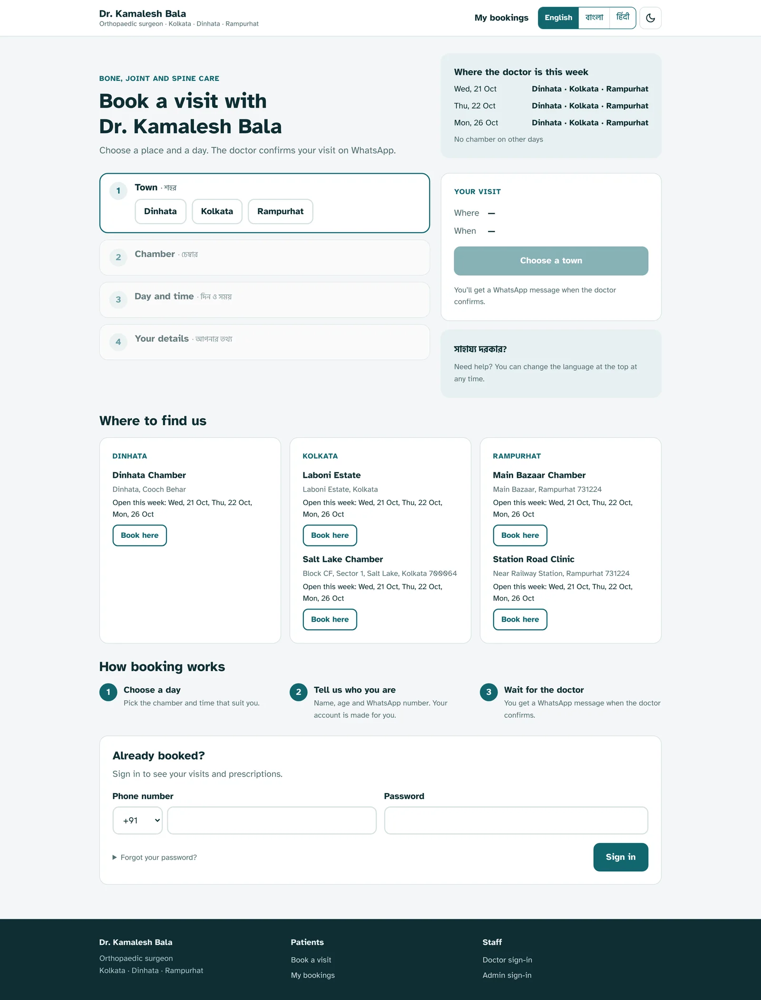
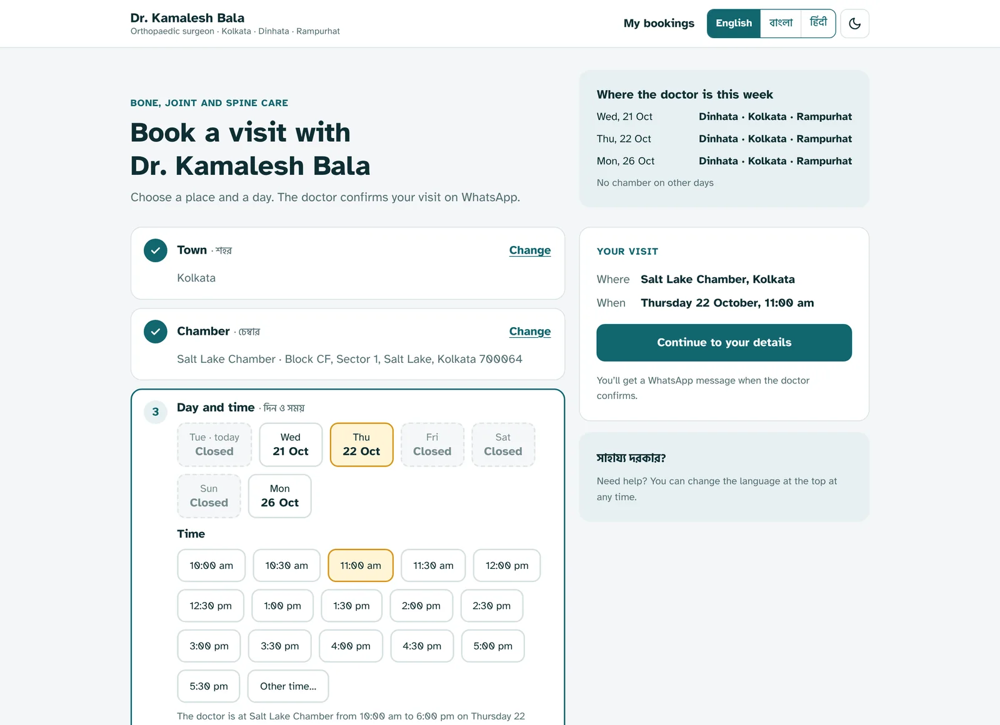
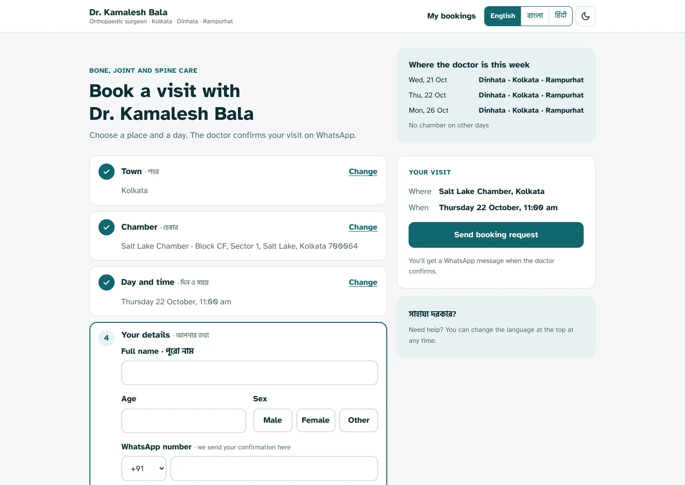
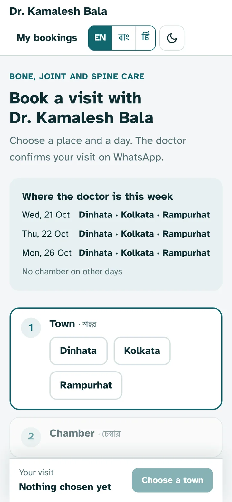
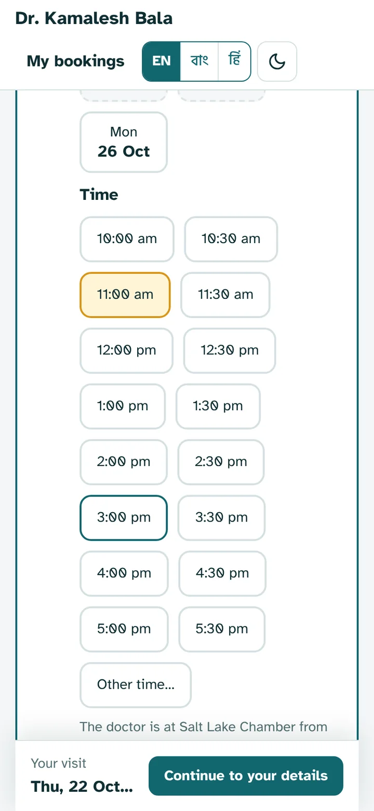
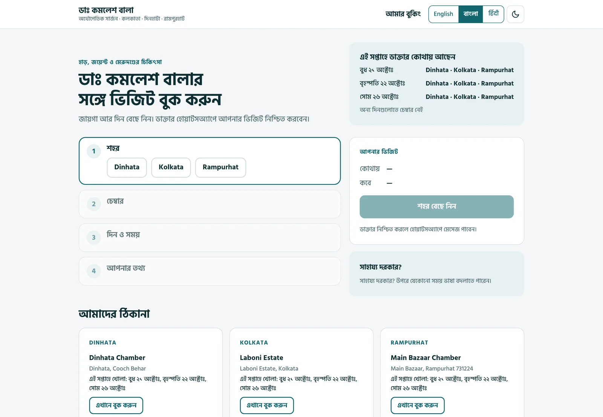
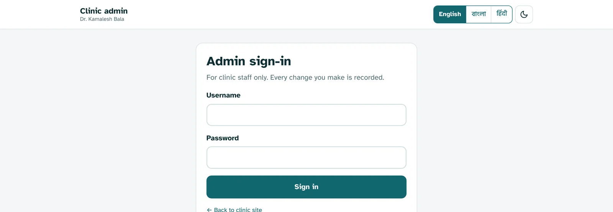

<!-- generated by scripts/build.py from data/projects.toml - edit the manifest, not this file -->

[← Back to profile](../README.md#featured-work)

# Appointment Booking Platform

**Booking, scheduling and prescriptions for a live orthopedic clinic**

Booking system for a live orthopedic clinic: patient booking, the doctor's daily schedule, an admin panel and WhatsApp notifications.

**3 portals: patient, doctor, admin** · **7-day availability view**

**Stack:** `Node.js` `Express` `PostgreSQL` `Twilio`  
**Live:** [drbalaortho.com](https://drbalaortho.com/)

## Screenshots (7)

<table>
<tr>
<td align="center" valign="top"> Booking home: the doctor&#x27;s week, the three towns and their chambers, and returning-patient sign-in</td>
</tr>
</table>

<table>
<tr>
<td align="center" valign="top" width="50%"> Day and time: the chamber&#x27;s open days and half-hour slots</td>
<td align="center" valign="top" width="50%"> Patient details: nothing is confirmed until the doctor approves on WhatsApp</td>
</tr>
</table>

<table>
<tr>
<td align="center" valign="top"> Booking on mobile: pick a town to start</td>
<td align="center" valign="top"> Picking a slot on mobile, with the visit summary pinned to the bottom</td>
</tr>
</table>

<table>
<tr>
<td align="center" valign="top"> The whole site in Bengali, with Hindi and English one tap away</td>
</tr>
</table>

<table>
<tr>
<td align="center" valign="top"> Clinic admin sign-in for staff</td>
</tr>
</table>

---

[← Robust Health](robust-health.md) · [All projects](../README.md#featured-work) · [Alignr →](alignr.md)
