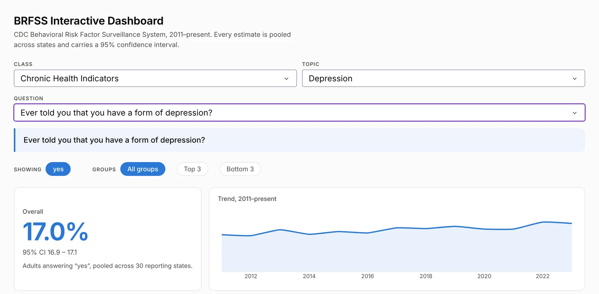
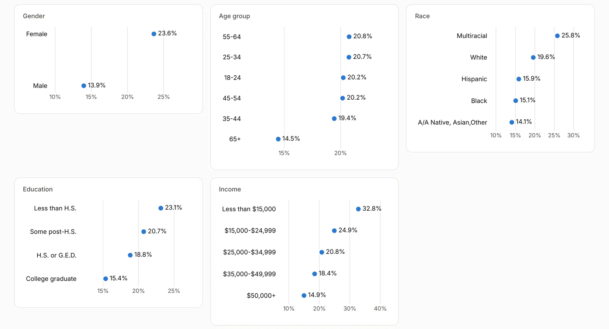
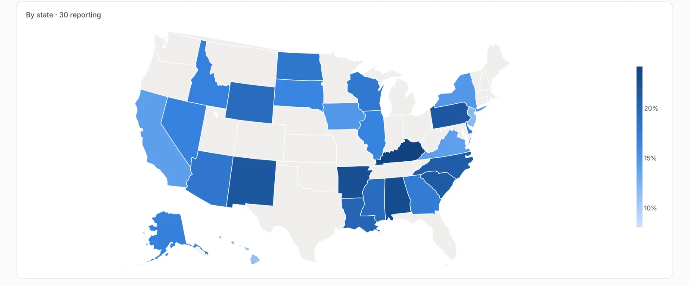

<!-- generated by scripts/build.py from data/projects.toml - edit the manifest, not this file -->

[← Back to profile](../README.md#featured-work)

# BRFSS Health Dashboard

**Every CDC BRFSS survey question, broken down on one screen**

Pick any CDC BRFSS survey question (2011–present) and see it by gender, age, race, education, income, year and state, with a 95% interval on every estimate.

**7 breakdowns per question** · **1 GB survey pre-aggregated to 0.68 MB** · **Serverless on Vercel**

**Stack:** `Python` `Plotly Dash` `pandas` `Vercel`  
**Live:** [brfssdashanalysis.vercel.app](https://brfssdashanalysis.vercel.app/)  
**Code:** [github.com/SwapnanilBala/BRFSS_Dash_App](https://github.com/SwapnanilBala/BRFSS_Dash_App)

## Screenshots (3)

<table>
<tr>
<td align="center" valign="top" width="50%"> Question picker, overall estimate with its interval, and the 2011–present trend</td>
<td align="center" valign="top" width="50%"> Breakdowns by gender, age, race, education and income, each group sorted and labelled</td>
</tr>
</table>

<table>
<tr>
<td align="center" valign="top"> State map: the estimate in each of the 30 reporting states</td>
</tr>
</table>

---

[← Alignr](alignr.md) · [All projects](../README.md#featured-work) · [GridWorld Search Visualizer →](gridworld.md)
