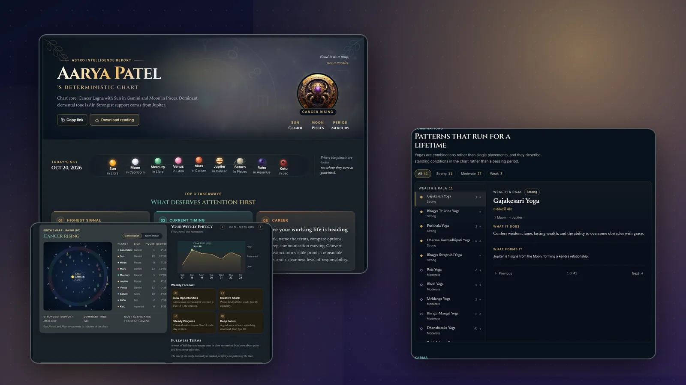
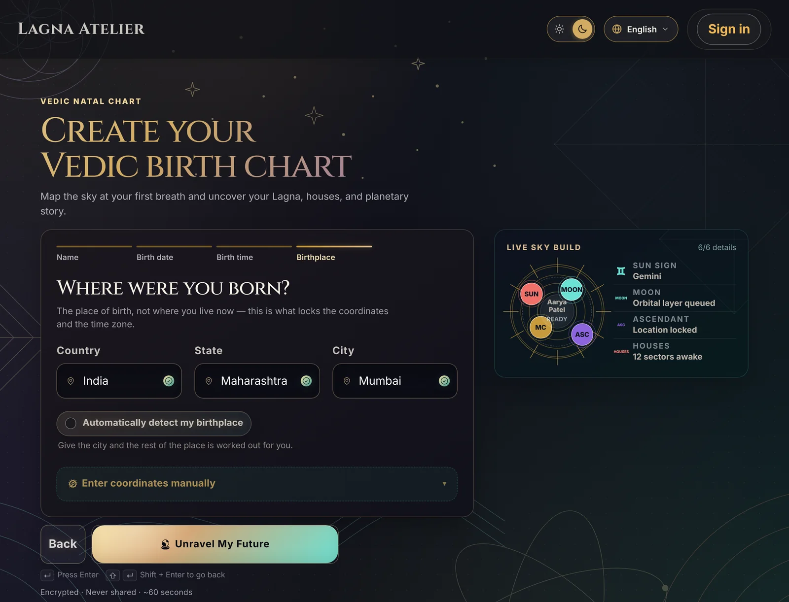
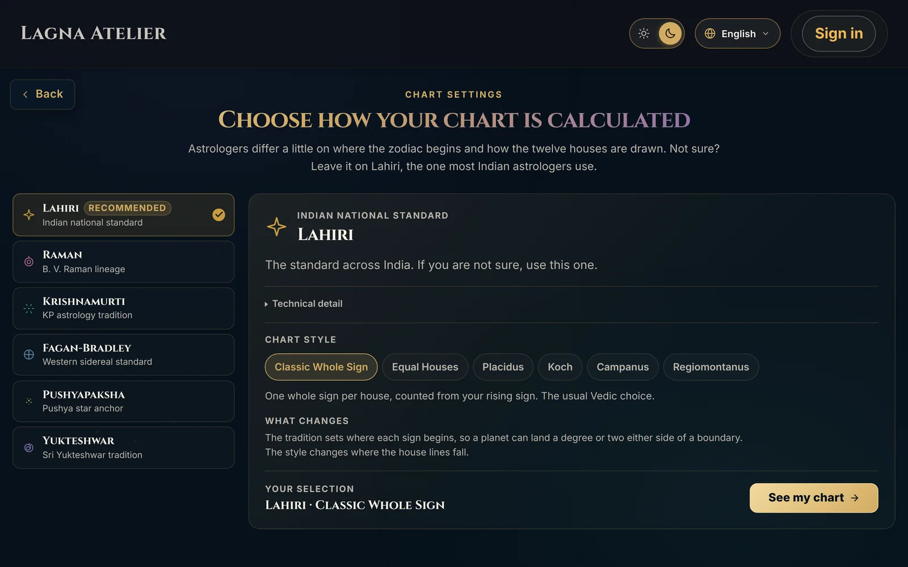
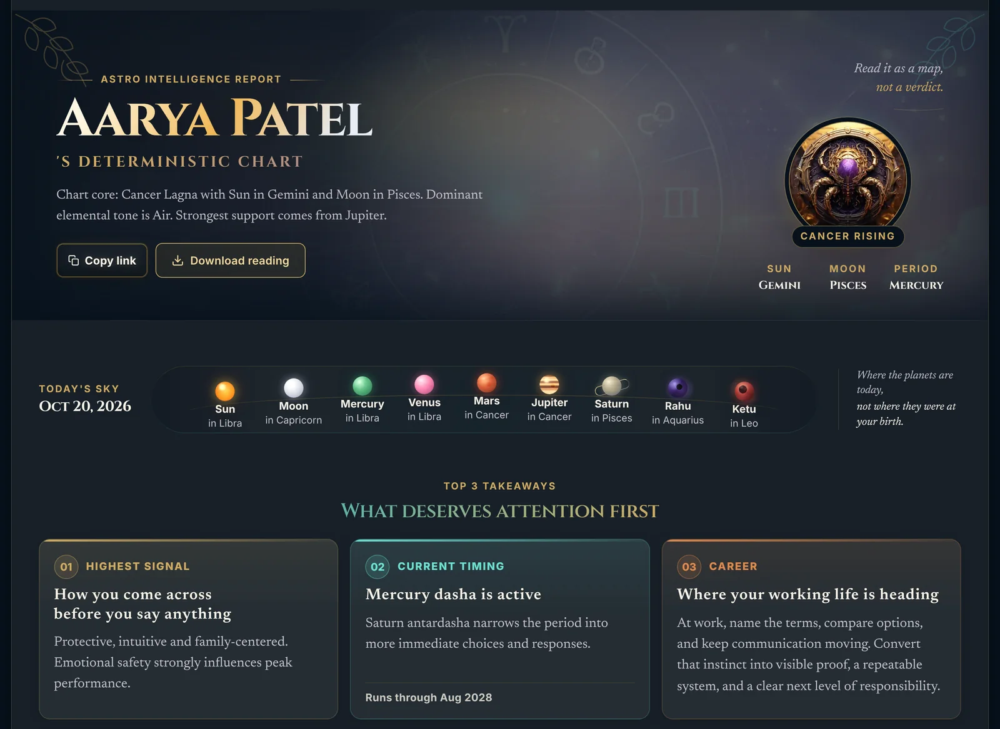
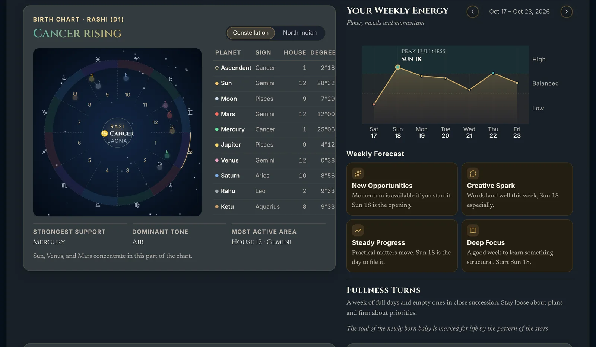
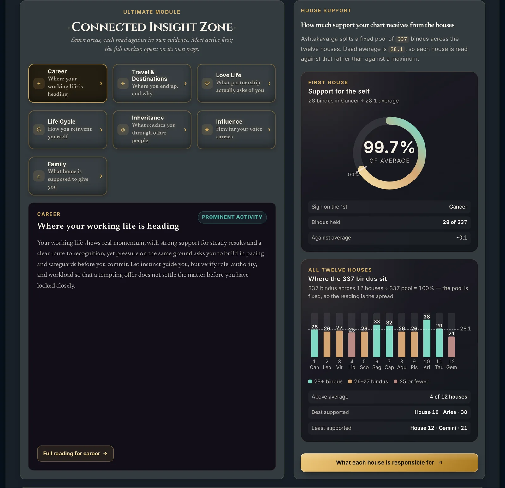
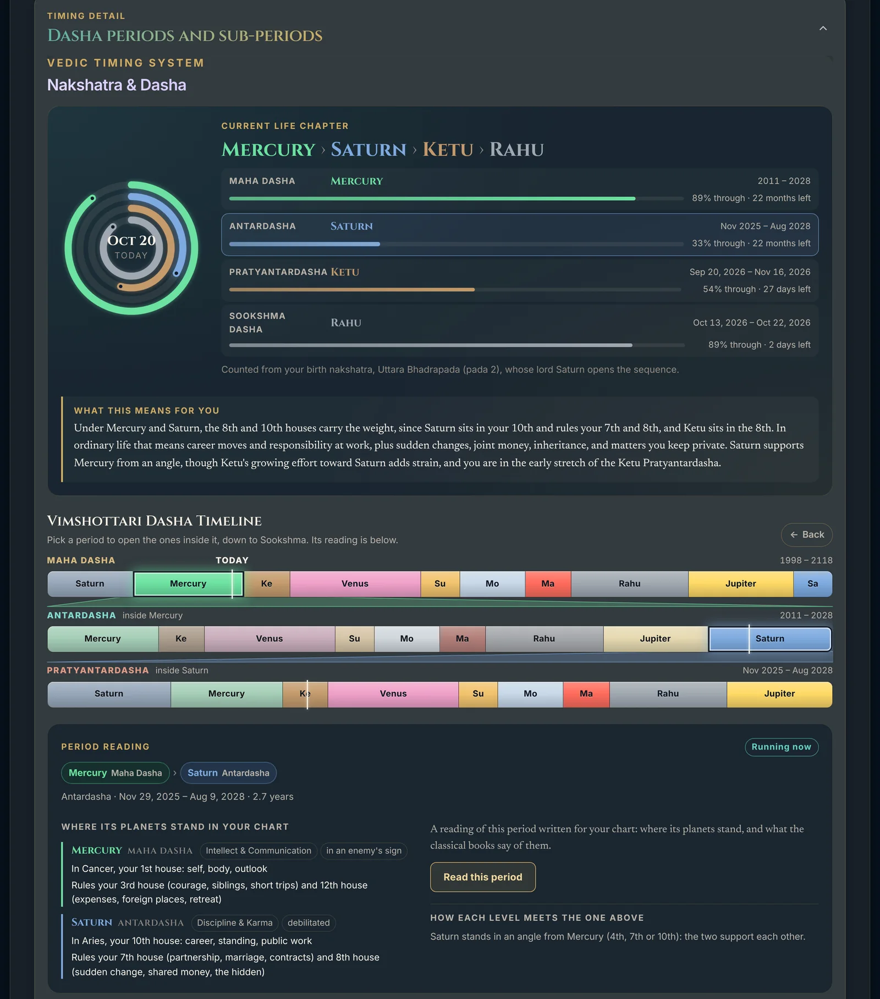
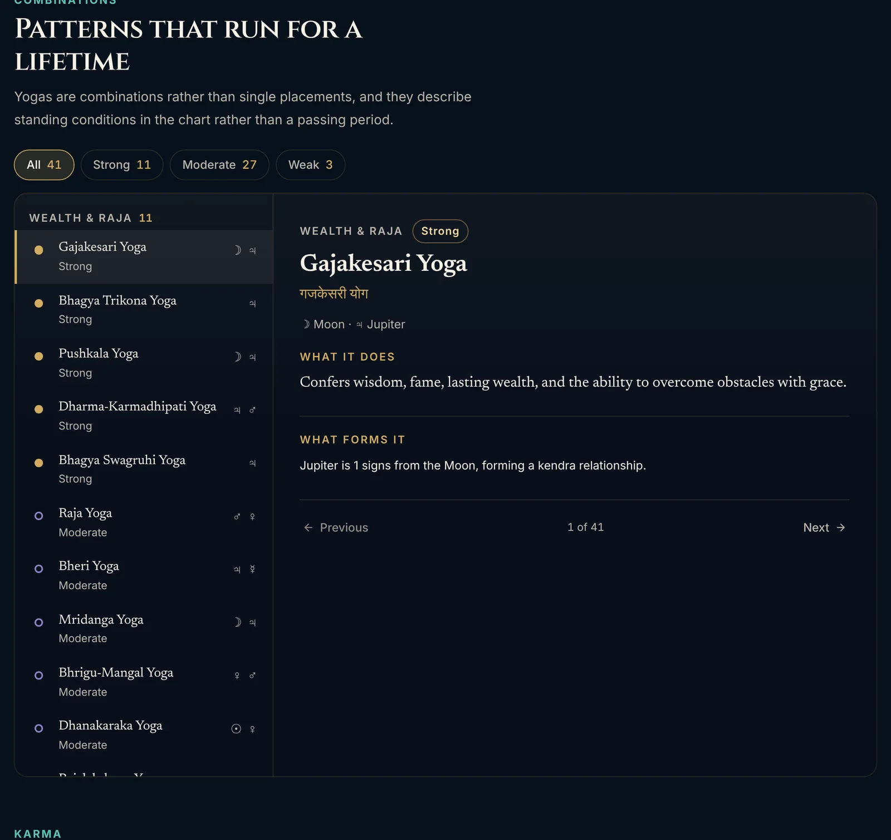
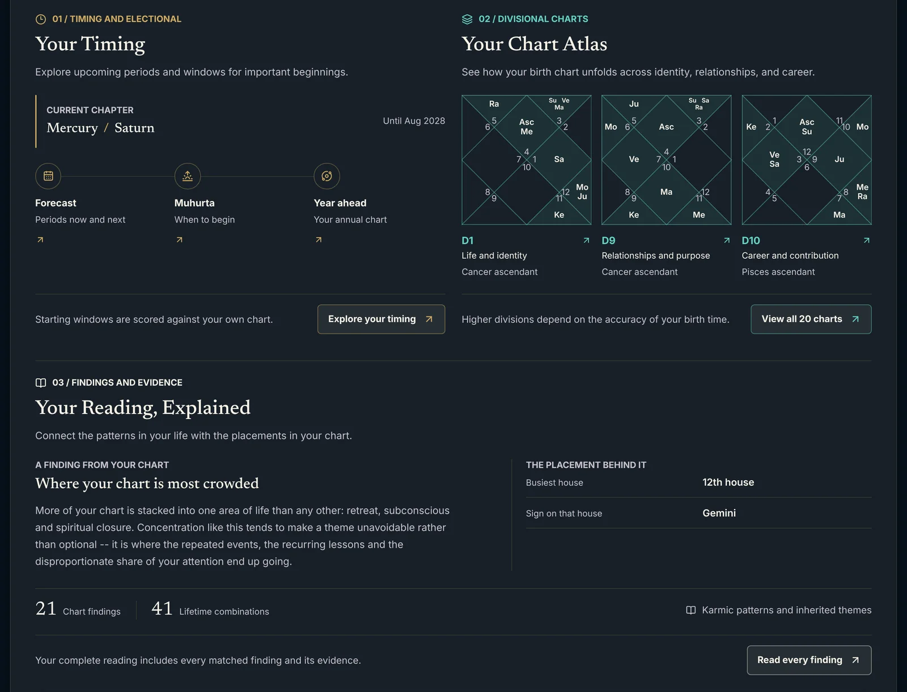

<!-- generated by scripts/build.py from data/projects.toml - edit the manifest, not this file -->

[← Back to profile](../README.md#featured-work)

# Lagna Atelier

**Vedic birth charts with AI-written interpretations**

Vedic astrology engine: birth charts across six ayanamshas and six house systems, dasha timelines, yoga detection and AI palm reading.

**1,863 tests** · **20 divisional charts** · **51 yogas detected**

**Stack:** `Next.js` `TypeScript` `astronomy-engine` `Neon + Drizzle` `Claude vision`  
**Live:** [lagnaatelier.site](https://lagnaatelier.site/)  
**Code:** [github.com/SwapnanilBala/Large_Astro_Web_App](https://github.com/SwapnanilBala/Large_Astro_Web_App)

## Screenshots (8)

<table>
<tr>
<td align="center" valign="top" width="50%"> Guided onboarding: name, birth date, time and place, with a live sky preview</td>
<td align="center" valign="top" width="50%"> Calculation settings: choose the ayanamsa and house system behind the chart</td>
</tr>
</table>

<table>
<tr>
<td align="center" valign="top" width="50%"> Chart overview: today&#x27;s sky, the core placements and the three takeaways that matter first</td>
<td align="center" valign="top" width="50%"> Rashi chart wheel and placements, next to the week&#x27;s energy forecast</td>
</tr>
</table>

<table>
<tr>
<td align="center" valign="top" width="50%"> Connected Insight Zone: seven life areas, plus Ashtakavarga support across the twelve houses</td>
<td align="center" valign="top" width="50%"> Vimshottari Dasha timing: the current chapter down to Sookshma, a full timeline and a period reading</td>
</tr>
</table>

<table>
<tr>
<td align="center" valign="top" width="50%"> Lifetime yogas: detected planetary combinations, filtered by strength</td>
<td align="center" valign="top" width="50%"> Chart atlas and findings: D1, D9 and D10 charts, and the evidence behind each reading</td>
</tr>
</table>

---

[All projects](../README.md#featured-work) · [Robust Health →](robust-health.md)
