<!-- generated by scripts/build.py from data/projects.toml - edit the manifest, not this file -->

[← Back to profile](../README.md#featured-work)

# Robust Health

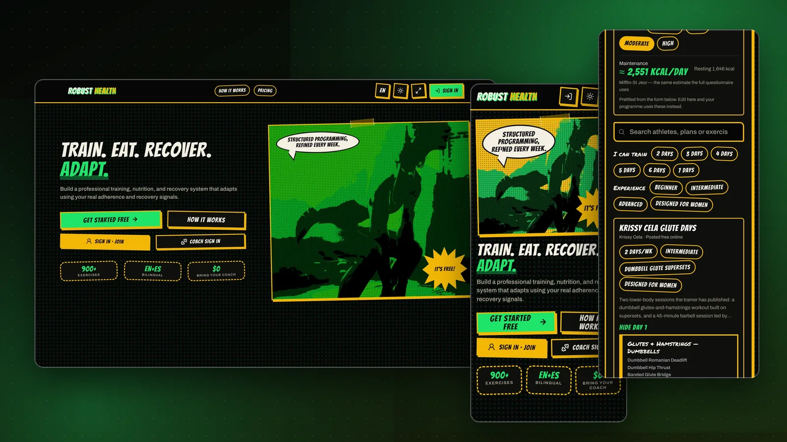

**Programming, tracking and nutrition in one app**

Fitness PWA that turns a member's profile into weekly training, nutrition and sleep plans, with separate member and trainer portals.

**23 training programmes** · **900+ exercises** · **−50% web load time**

**Stack:** `Next.js` `TypeScript` `Supabase` `Claude API` `Vercel`  
**Live:** [app.robusthealth.in](https://app.robusthealth.in/)

## Screenshots (10)

<table>
<tr>
<td align="center" valign="top" width="25%">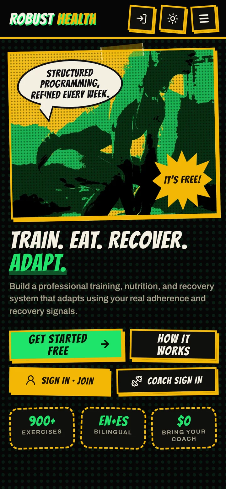 Mobile home: train, eat, recover, adapt</td>
<td align="center" valign="top" width="25%">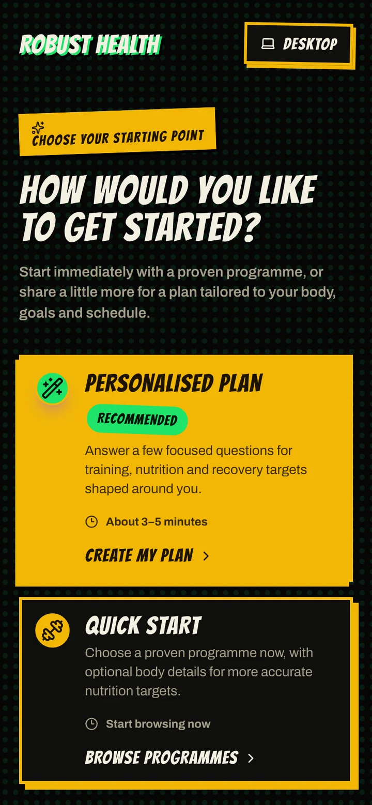 Getting started on mobile: a personalised plan or a quick start</td>
<td align="center" valign="top" width="25%">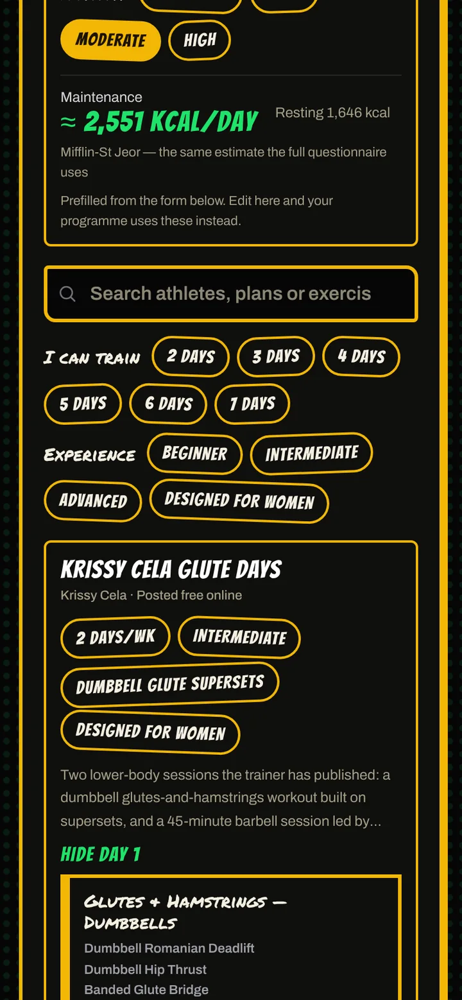 Quick start: maintenance calories from your numbers, and a peek at Day 1 of a programme</td>
<td align="center" valign="top" width="25%">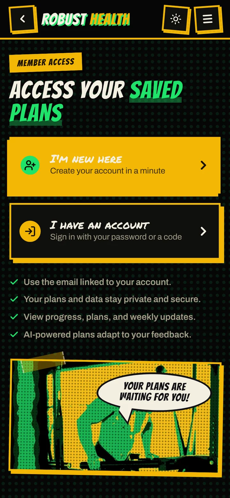 Member sign-in on mobile: create an account or sign in</td>
</tr>
</table>

<table>
<tr>
<td align="center" valign="top" width="50%">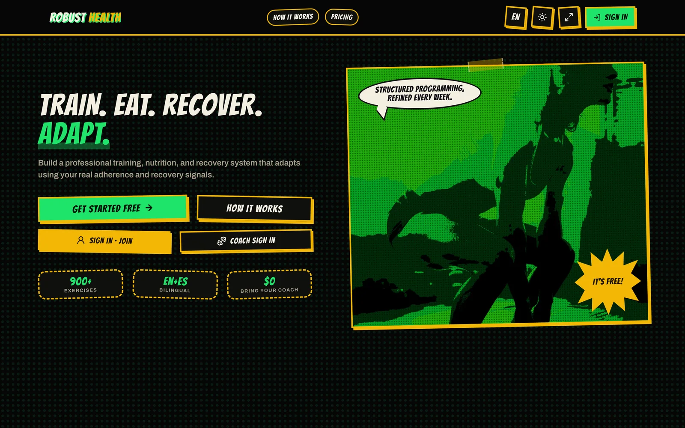 Landing page: training, nutrition and recovery that adapt to real adherence</td>
<td align="center" valign="top" width="50%">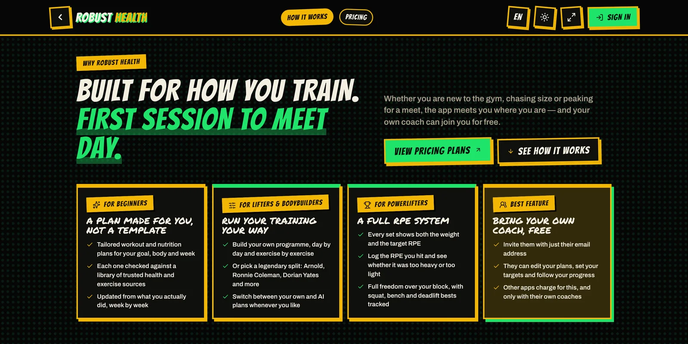 Built for beginners, lifters and powerlifters, with your own coach for free</td>
</tr>
</table>

<table>
<tr>
<td align="center" valign="top" width="50%">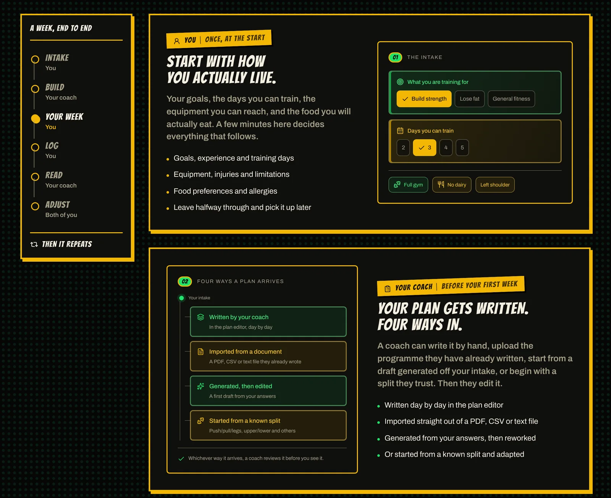 How a week works: the intake, then a plan written four ways and reviewed by a coach</td>
<td align="center" valign="top" width="50%">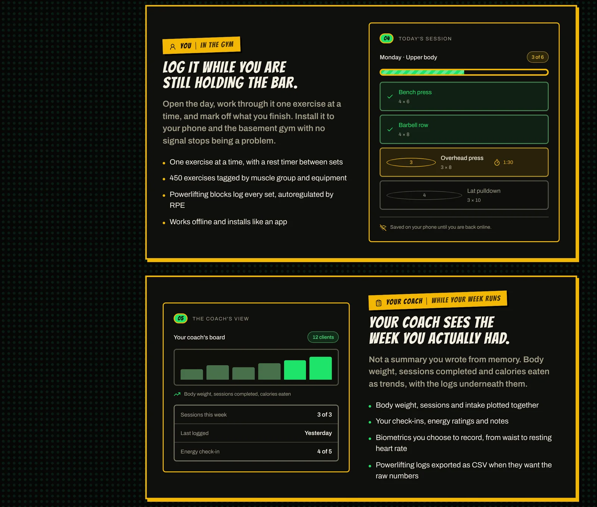 Logging a session in the gym, and the coach&#x27;s view of the week</td>
</tr>
</table>

<table>
<tr>
<td align="center" valign="top" width="50%">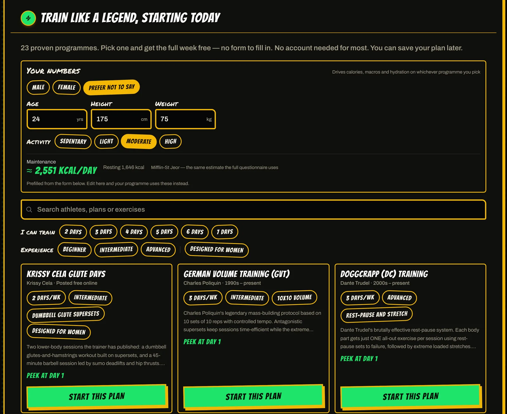 Programme library: 23 proven programmes with filters and calorie targets</td>
<td align="center" valign="top" width="50%">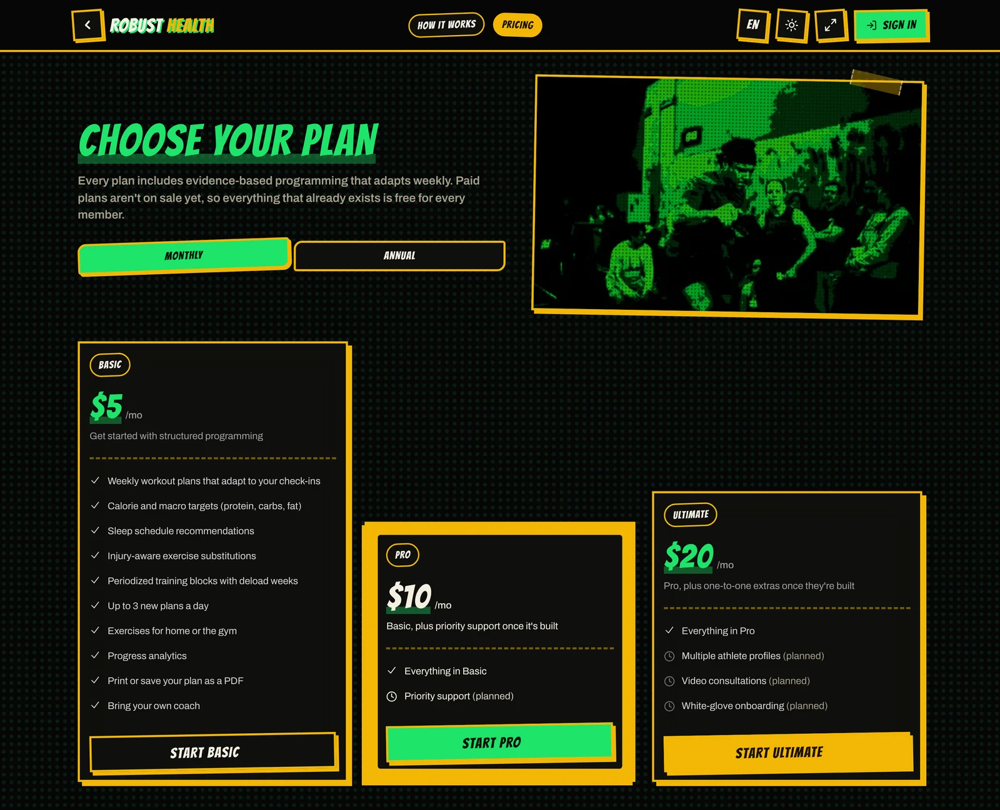 Plans: Basic, Pro and Ultimate, with everything free while paid plans are off sale</td>
</tr>
</table>

---

[← Lagna Atelier](lagna-atelier.md) · [All projects](../README.md#featured-work) · [Appointment Booking Platform →](appointment-booking.md)
